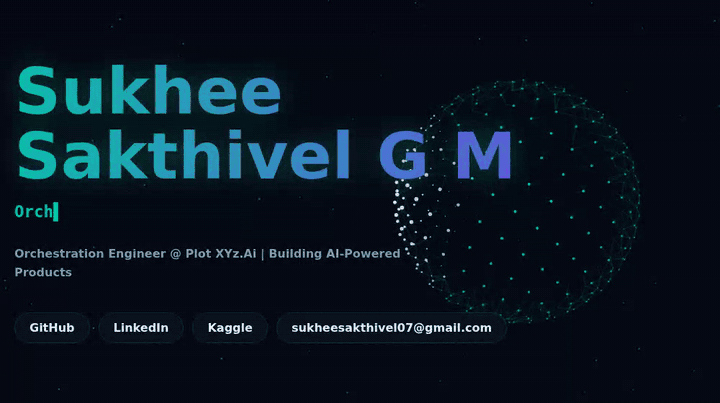
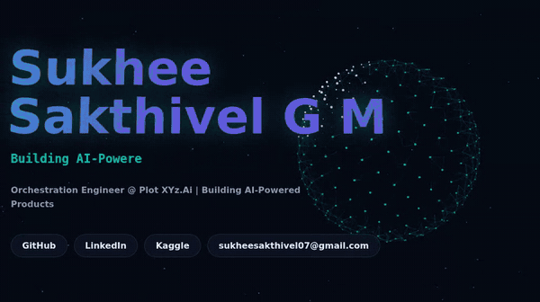

<div align="center">

<a href="https://sukhee-2626.github.io/sukhee-2626/">

</a>

**Orchestration Engineer @ Plot XYz.Ai | Building AI-Powered Products**

<a href="https://sukhee-2626.github.io/sukhee-2626/"></a>
<a href="https://github.com/sukhee-2626"></a>
<a href="https://www.linkedin.com/in/sukheesakthivel/"></a>
<a href="https://www.kaggle.com/sukheesakthivel"></a>
<a href="mailto:sukheesakthivel07@gmail.com"></a>

<br/><br/>



</div>

---

## 🚀 Top 10 Projects

<table>
<tr>
<td width="50%" valign="top">

### 01 · [plot-docs](https://github.com/sukhee-2626/plot-docs)
Local-first AI office suite for Docs, Sheets, Slides, PDF, Markdown and HTML on Windows, macOS and Linux.

`Electron` `TypeScript`

</td>
<td width="50%" valign="top">

### 02 · [Thinai](https://github.com/sukhee-2626/Thinai)
Privacy-focused Android app running small language models on-device with a local API.

`Dart` `On-device AI`

</td>
</tr>
<tr>
<td valign="top">

### 03 · [MediNexus AI](https://github.com/sukhee-2626/MediNexus-AI-Updated)
Healthcare platform: patient records, appointments, consent management, AI insights and patient portals.

`React` `TypeScript` `Supabase` `Gemini`

</td>
<td valign="top">

### 04 · [CareLens](https://github.com/sukhee-2626/carelens-hospital-agent)
Hospital AI assistant for document extraction, health timelines, search, FAQ retrieval, appointments and audit trails.

`React` `TypeScript` `Azure AI`

</td>
</tr>
<tr>
<td valign="top">

### 05 · [CodeGuard](https://github.com/sukhee-2626/CodeGuardAI)
Browser-based GitHub security scanner with vulnerability analysis, security scoring, auto-fixes and Markdown reports.

`React` `GitHub REST API`

</td>
<td valign="top">

### 06 · [Campus Navigator](https://github.com/sukhee-2626/CAMPUS-NAV)
Interactive college map and field-survey app with GPS detection, searchable destinations and saved pins.

`React` `Express` `MySQL/TiDB`

</td>
</tr>
<tr>
<td valign="top">

### 07 · [SSOFFICE](https://github.com/sukhee-2626/SSOFFICE)
Full-stack office suite: docs, sheets, slides, forms, mail, calendar, drive, tasks, automation and AI.

`React` `TypeScript` `Supabase`

</td>
<td valign="top">

### 08 · [VastuAI](https://github.com/sukhee-2626/VastuAi)
Floor-plan analyzer combining Gemini Vision with a custom rule engine, scoring and improvement tips.

`React` `Flask` `Gemini Vision`

</td>
</tr>
<tr>
<td valign="top">

### 09 · [Place1-Ai](https://github.com/sukhee-2626/Place1-Ai)
AI career copilot with polished frontend, backend API, authentication and database integration.

`Next.js` `Tailwind` `Supabase`

</td>
<td valign="top">

### 10 · [PRD Craftsman](https://github.com/sukhee-2626/prd-craftsman-10)
AI product-requirements prompt generator with structured templates.

`TypeScript` `Generative AI`

</td>
</tr>
</table>

---

## 🏆 Hackathons & Achievements

| | Achievement | Details |
|---|---|---|
| 🥉 | **[Featastiv AI](https://lnkd.in/g5aypTxY)** | 3rd Prize, Ideathon ThinkTank 2026. AI healthcare scheduling and live queue management. |
| ⛓️ | **[MediChain Spark](https://lnkd.in/gvartgug)** | GDG TechSprint Hackathon 2025. Blockchain medical records with immutable transparency. |
| 🎓 | **[Certificate Portal](https://lnkd.in/gqbSV8Ay)** | Official GDG TechSprint portal with Credential ID and QR verification, instant PDFs. |
| 📝 | **[AI PRD Generator](https://lnkd.in/gT4379-b)** | Turns raw ideas into structured 11-section PRDs in seconds. Built with Lovable. |

---

## 💼 Experience

| Role | Organisation | Period |
|---|---|---|
| **Orchestration Engineer** | Plot XYz.Ai. Building AI-powered products. | Current |
| **Data Analyst Intern** | Oasis Infobyte · Virtual. Data-focused internship with exposure to IT infrastructure and support services. | Aug 2026 – Present |
| **Campus Ambassador, E-Cell** | IIT Bombay. Supported campus outreach and entrepreneurship initiatives. | Jun 2026 – Present |
| **Media & Creative Team Head** | GDG on Campus. Led media and creative activities, event promotion and technical community engagement. | Jun 2025 – Present |
| **Language Intern** | GLA University, Mathura. Completed an on-site language internship. | Jun 2026 |
| **Desktop Support Technician** | Smart Stream Technologies · Part-time. Technical support with exposure to desktop support and data engineering. | Apr – May 2026 |

---

## 🎓 Education

| Course | Institution | Period / Score |
|---|---|---|
| **B.Sc. Computer Science** | Sri Krishna Arts and Science College (SKASC). 1st year, pursuing. | 2025 – 2028 |
| **12th · Commerce + Computer Science** | Higher secondary education. | 71.6% |
| **10th** | Secondary education. | 62% |

---

## 🛠️ Technical Skills

**Programming**  


**AI & Data**  


**Web**  


**Cloud**  


**Security**  


**Tools**  


---

## 📜 Certifications

| Issuer | Certification | Date |
|---|---|---|
| **Anthropic** | AI Fluency Framework & Foundations | Jun 2026 |
| **Google** | Gen AI Apps with Gemini & Streamlit · Google Cloud Network, Data & Compute · Vertex AI Prompt Design · Generative AI · Speech & Language APIs | Oct 2025 |
| **GDG** | SKASC Tech Sprint | Jan 2026 |
| **Great Learning** | WordPress with Docker | |
| **Cisco** | Introduction to Cybersecurity | Oct 2024 |
| **HackerRank** | Python (Basic) | Oct 2024 |

---

<div align="center">


</div>

---

## 🧰 Run it yourself

```bash
npm install            # dependencies: serve, playwright
npm start              # live portfolio at http://localhost:3000
npm run setup          # one time: installs Chromium for recording
npm run record         # re-records assets/particles.gif + assets/tour.gif (needs ffmpeg)
```

- `index.html` is the full interactive portfolio (3D particle sphere, typing, tilt cards, glow).
- GitHub **Pages** deploys it automatically (`.github/workflows/pages.yml`).
- The **Record** workflow regenerates the README GIFs with Inter and Fira Code installed.

<div align="center">

Keep building, keep innovating 🚀

</div>
