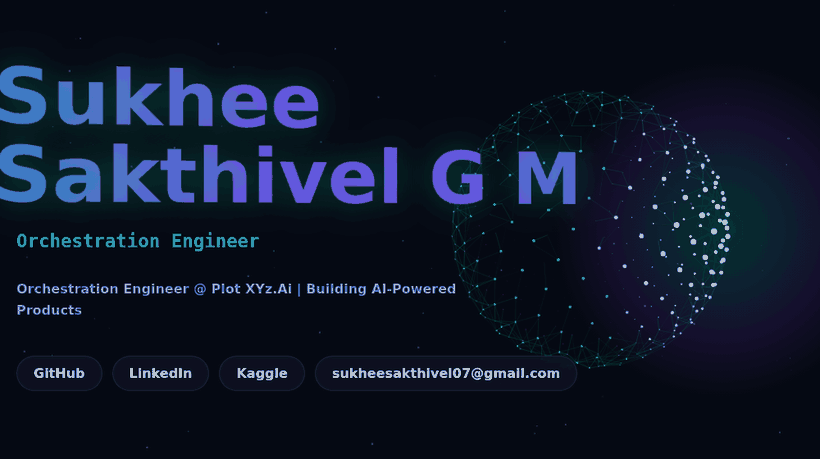
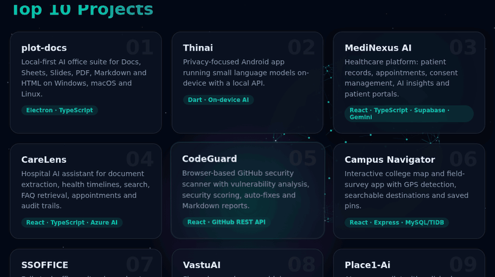
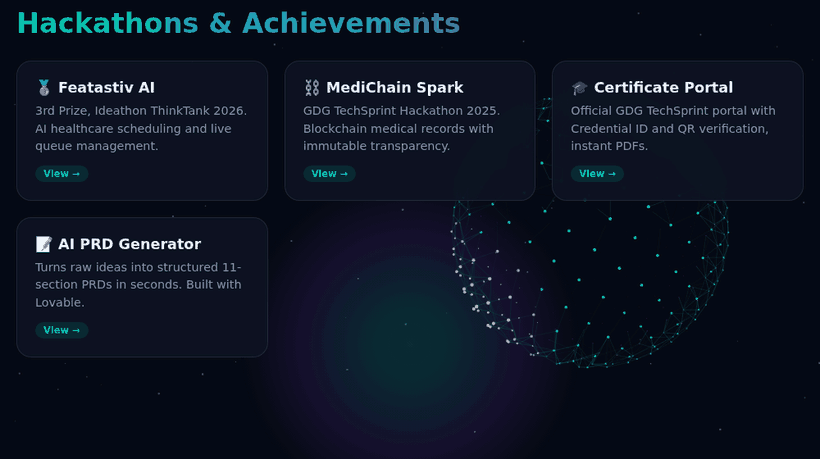

 

| # | Project | Stack |
|---|---|---|
| 01 | [plot-docs](https://github.com/sukhee-2626/plot-docs) | Electron · TypeScript |
| 02 | [Thinai](https://github.com/sukhee-2626/Thinai) | Dart · On-device AI |
| 03 | [MediNexus AI](https://github.com/sukhee-2626/MediNexus-AI-Updated) | React · TypeScript · Supabase · Gemini |
| 04 | [CareLens](https://github.com/sukhee-2626/carelens-hospital-agent) | React · TypeScript · Azure AI |
| 05 | [CodeGuard](https://github.com/sukhee-2626/CodeGuardAI) | React · GitHub REST API |
| 06 | [Campus Navigator](https://github.com/sukhee-2626/CAMPUS-NAV) | React · Express · MySQL/TiDB |
| 07 | [SSOFFICE](https://github.com/sukhee-2626/SSOFFICE) | React · TypeScript · Supabase |
| 08 | [VastuAI](https://github.com/sukhee-2626/VastuAi) | React · Flask · Gemini Vision |
| 09 | [Place1-Ai](https://github.com/sukhee-2626/Place1-Ai) | Next.js · Tailwind · Supabase |
| 10 | [PRD Craftsman](https://github.com/sukhee-2626/prd-craftsman-10) | TypeScript · Generative AI |

<b>🏆 Hackathons & Achievements</b>

- 🥉 [**Featastiv AI**](https://lnkd.in/g5aypTxY): 3rd Prize, Ideathon ThinkTank 2026. AI healthcare scheduling and live queue management.
- ⛓️ [**MediChain Spark**](https://lnkd.in/gvartgug): GDG TechSprint Hackathon 2025. Blockchain medical records with immutable transparency.
- 🎓 [**Certificate Portal**](https://lnkd.in/gqbSV8Ay): Official GDG TechSprint portal with Credential ID and QR verification, instant PDFs.
- 📝 [**AI PRD Generator**](https://lnkd.in/gT4379-b): Turns raw ideas into structured 11-section PRDs in seconds. Built with Lovable.

<b>💼 Experience</b>

| Role | Details | Period |
|---|---|---|
| **Orchestration Engineer** | Plot XYz.Ai. Building AI-powered products. | Current |
| **Data Analyst Intern** | Oasis Infobyte · Virtual | Aug 2026 – Present |
| **Campus Ambassador, E-Cell** | IIT Bombay | Jun 2026 – Present |
| **Media & Creative Team Head** | GDG on Campus | Jun 2025 – Present |
| **Language Intern** | GLA University, Mathura | Jun 2026 |
| **Desktop Support Technician** | Smart Stream Technologies · Part-time | Apr – May 2026 |

<b>🎓 Education</b>

- **B.Sc. Computer Science**, Sri Krishna Arts and Science College (SKASC), 1st year (2025 – 2028)
- **12th** Commerce + Computer Science: 71.6%
- **10th**: 62%

<b>🛠️ Technical Skills</b>

- **Programming:** Python, C++, JavaScript, TypeScript, DSA
- **AI & Data:** Generative AI, Prompt Engineering, Google Gemini, Azure AI, Data Engineering
- **Web:** React, Vite, Tailwind CSS, WordPress, Docker
- **Cloud:** Google Cloud, Supabase, PostgreSQL, MySQL/TiDB, REST APIs
- **Security:** Cybersecurity, Cisco Networking, Technical Support
- **Tools:** GitHub, VS Code, Google Workspace, Canva

<b>🏅 Certifications</b>

- **Anthropic:** AI Fluency Framework & Foundations (Jun 2026)
- **Google (Oct 2025):** Gen AI Apps with Gemini & Streamlit · Google Cloud Network, Data & Compute · Vertex AI Prompt Design · Generative AI · Speech & Language APIs
- **GDG:** SKASC Tech Sprint (Jan 2026)
- **Great Learning:** WordPress with Docker
- **Cisco:** Introduction to Cybersecurity (Oct 2024)
- **HackerRank:** Python (Basic) (Oct 2024)

