

<a href="https://sukhee-2626.github.io/sukhee-2626/"></a>


 

<table>
<tr><td width="50%" valign="top"><a href="https://github.com/sukhee-2626/plot-docs"></a></td><td width="50%" valign="top"><a href="https://github.com/sukhee-2626/Thinai"></a></td></tr>
<tr><td width="50%" valign="top"><a href="https://github.com/sukhee-2626/MediNexus-AI-Updated"></a></td><td width="50%" valign="top"><a href="https://github.com/sukhee-2626/carelens-hospital-agent"></a></td></tr>
<tr><td width="50%" valign="top"><a href="https://github.com/sukhee-2626/CodeGuardAI"></a></td><td width="50%" valign="top"><a href="https://github.com/sukhee-2626/CAMPUS-NAV"></a></td></tr>
<tr><td width="50%" valign="top"><a href="https://github.com/sukhee-2626/SSOFFICE"></a></td><td width="50%" valign="top"><a href="https://github.com/sukhee-2626/VastuAi"></a></td></tr>
<tr><td width="50%" valign="top"><a href="https://github.com/sukhee-2626/Place1-Ai"></a></td><td width="50%" valign="top"><a href="https://github.com/sukhee-2626/prd-craftsman-10"></a></td></tr>
</table>

 

<table>
<tr><td width="50%" valign="top"><a href="https://lnkd.in/g5aypTxY"></a></td><td width="50%" valign="top"><a href="https://lnkd.in/gvartgug"></a></td></tr>
<tr><td width="50%" valign="top"><a href="https://lnkd.in/gqbSV8Ay"></a></td><td width="50%" valign="top"><a href="https://lnkd.in/gT4379-b"></a></td></tr>
</table>

 


 


 


 


 

 

 

<table>
<tr>
<td width="50%" valign="top">

</td>
<td width="50%" valign="top">

</td>
</tr>
</table>

 

 

<picture>
  <source media="(prefers-color-scheme: dark)" srcset="https://raw.githubusercontent.com/sukhee-2626/sukhee-2626/output/github-snake-dark.svg"/>
  <source media="(prefers-color-scheme: light)" srcset="https://raw.githubusercontent.com/sukhee-2626/sukhee-2626/output/github-snake.svg"/>
  
</picture>

  

Keep building, keep innovating 🚀 · [Open the interactive version](https://sukhee-2626.github.io/sukhee-2626/)

